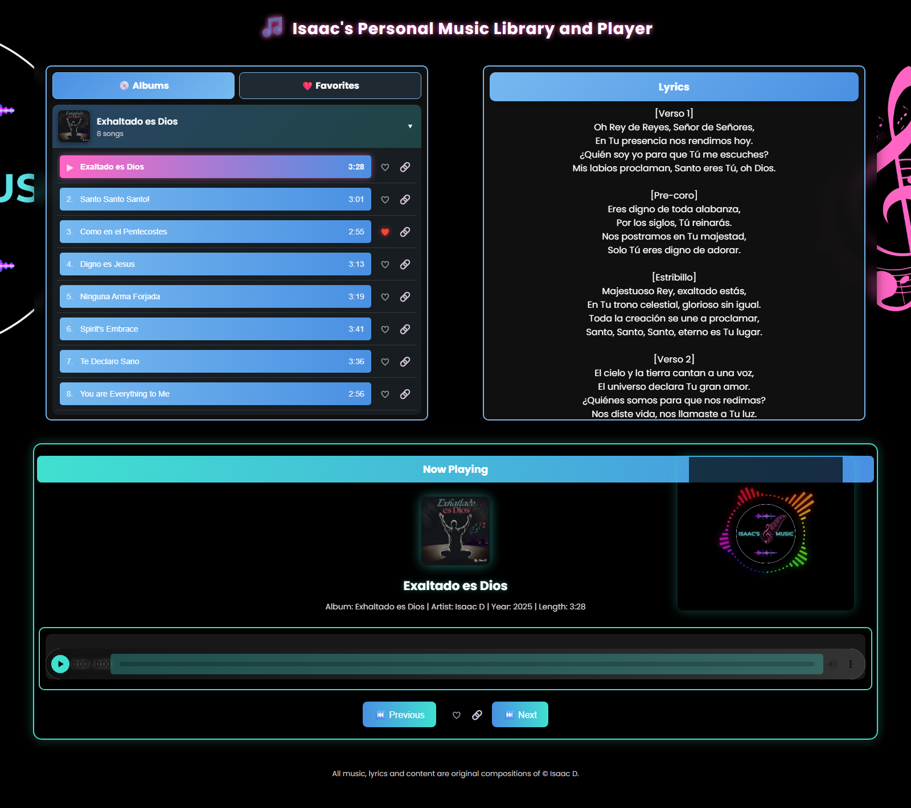

# 🎵 Music Library App (Dash & Flask)  

A sleek and interactive **music library app** built with **Dash & Flask**, featuring **real-time folder monitoring, metadata extraction, waveform visualization, and a favorites system**.  

## 🚀 Features  
- **🎼 Music Player** – Play songs with album artwork, metadata, and lyrics display.  
- **❤️ Favorites System** – Easily favorite/unfavorite songs, stored persistently in `favorites.json`.  
- **📂 Real-time Folder Monitoring** – Automatically updates when new songs are added.  
- **📊 Waveform Visualization** – View the audio waveform for each track.  
- **🎛️ Advanced Filtering** – Filter songs by **All Songs, Favorites, or By Album**.  
- **🎨 Modern UI** – Styled with a **light blue theme**, featuring a clean dropdown inside the "Available Songs" button.  

---

## 📌 Installation  

### 🔧 Requirements  
- **Python 3.8+**  
- **pip** installed  

### 💻 Setup  
1. **Clone the repository**:  
   ```bash
   git clone https://github.com/yourusername/music-library-app.git  
   cd music-library-app  
   ```  
2. **Create and activate a virtual environment** *(recommended)*:  
   ```bash
   python -m venv venv  
   source venv/bin/activate  # On macOS/Linux  
   venv\\Scripts\\activate     # On Windows  
   ```  
3. **Install dependencies**:  
   ```bash
   pip install -r requirements.txt  
   ```  
4. **Run the app**:  
   ```bash
   python app.py  
   ```  

---

## 🛠️ Usage  
- Click on a song to **play it and display lyrics**.  
- Use the **"Filter Dropdown"** inside the **"Available Songs"** button to switch views.  
- Click the **❤️ button** to favorite a song – it updates instantly!  
- Changes persist across restarts via `favorites.json`.  

---

## 🔗 Share Site (GitHub Pages)  
Share links open a page that plays only that song (no albums), hosted on GitHub Pages so it is always online and social media previews load instantly (no Render wake-up wait). The share site has no library page: its home page and unknown addresses open the featured song.  
- `build_static.py` builds it from `MusicAlbums` into `site/` (one share page per song at `/s/<song>/`).  
- `.github/workflows/pages.yml` rebuilds and publishes it to GitHub Pages on every push to `main`.  
- Album names, order, covers and the featured song are set at the top of `library.py`.  
- Preview locally: `python build_static.py` then `python -m http.server -d site 8000`.  

---

## 🖼️ UI Preview  
  

---

## 🎯 To-Do  
- ✅ Fix **dropdown placement** inside "Available Songs".  
- ✅ Ensure **favorites persist across restarts**.  
- ✅ Style dropdown and filter buttons properly.  
- ⏳ Add **more themes and customization options**.  

---

## 🤝 Contributing  
Pull requests are welcome! Feel free to fork and submit PRs for improvements.  

---

## 📜 License  
This project is licensed under the **MIT License**.  

---

## ©️ Copyright  
**All music and content in this application are original compositions and copyrighted by [Isaac D.]. Unauthorized reproduction or distribution is strictly prohibited.**  


