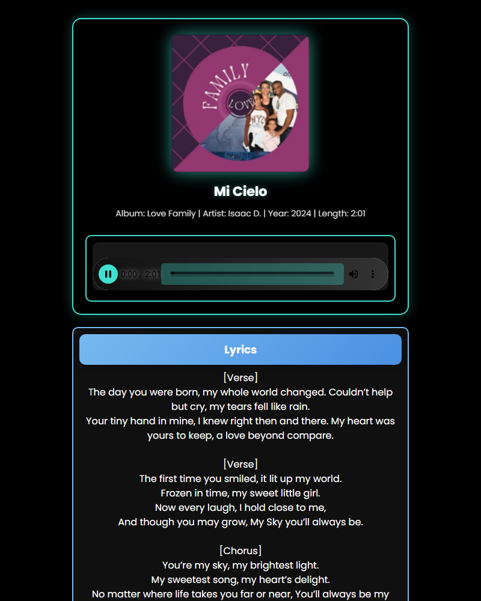

# 🎵 Sack's Music Library (Dash & Flask)

A personal music library and player built with **Dash & Flask** for Isaac D.'s original songs, with **expandable albums, lyrics, favorites, and shareable single-song links** that are always online.

- 🎧 **Share site (always online):** https://sack2116.github.io/Sacks-Music-Library/
- 🎼 **Full player:** the Dash app in this repo, hosted on Render


---

## 🚀 Features

### 🎼 Music Player
- **💿 Expandable albums** – songs are grouped by album with cover art and song count; click an album to open or close it.
- **▶️ Plays on launch** – the featured song (**Exaltado es Dios**) starts automatically and its album opens. If the browser blocks autoplay, a **"▶ Tap to play"** button appears and the song starts on the first tap.
- **⏮️ ⏭️ Previous / Next within the album** – navigation stays inside the album of the song that is playing and loops back to the start. When a song ends, the next song in the album plays.
- **📝 Lyrics** – shown next to the song list for the song that is playing.
- **❤️ Favorites** – tap the heart on any song or in Now Playing. Hearts show a **grey outline (♡)** when a song is not a favorite and turn **solid red (♥)** when it is. The **Favorites** tab lists them all, and they are saved in `favorites.json`.
- **🔗 Share** – every song (and Now Playing) has a share button that creates a link to that single song. On phones it opens the share menu (WhatsApp, Messages, Facebook...); on computers it copies the link.

### 🔗 Share Links (single-song pages)


Share links look like `https://sack2116.github.io/Sacks-Music-Library/s/mi-cielo/` and open a page that plays **only that song**: cover art, title, album details, player and lyrics. No albums or other songs are shown.

- **⚡ Always online** – share pages are hosted on **GitHub Pages**, so they open instantly. There is no Render wake-up wait for the people you share with.
- **🖼️ Social media previews** – each page includes Open Graph / Twitter tags, so Facebook, WhatsApp, X, Messages and others show the song title, album and cover art. Check how a link will look with Facebook's [Sharing Debugger](https://developers.facebook.com/tools/debug/).
- **🔒 No library page** – the share site has no page that lists the albums. If someone trims the link (e.g. deletes `s/mi-cielo/`) or types an address that does not exist, they are sent back to the song they were shared. If no song was opened in that browser, they get the featured song.

> **Note:** share links are built from song titles (e.g. `/s/madre-mia/`), so someone could guess another song's link. This repository is public, so the song files can also be downloaded from GitHub.

---

## 📁 Project Structure

| Path | What it is |
|---|---|
| `app.py` | The Dash player (albums, Now Playing, lyrics, favorites, share buttons). |
| `library.py` | Reads `MusicAlbums` and holds the settings: album names/order/covers, featured song, title overrides and share site address. |
| `build_static.py` | Builds the share site (one page per song) into `site/`. |
| `static_site/` | Templates and styles for the share pages. |
| `.github/workflows/pages.yml` | Rebuilds and publishes the share site to GitHub Pages on every push to `main`. |
| `assets/` | Player styles (`style.css`), player scripts (`player.js`), background image and video. |
| `MusicAlbums/` | The music: one folder per album, songs and lyrics inside. |
| `favorites.json` | Saved favorites for the Dash player. |
| `Procfile` | Start command for Render (`gunicorn app:server`). |
| `StartMusicPlayer.bat` | Windows shortcut that installs packages and opens the player locally. |

---

## 🎶 Adding Songs and Albums

1. Each **top-level folder** in `MusicAlbums` is an album. Put each song's `.mp3` (in its own subfolder if you like) inside its album folder.
2. Add the lyrics as a `.txt` file (UTF-8) in the same folder as the song. A file with the same name as the `.mp3` is used first; otherwise the first `.txt` in that folder.
3. Song title, artist, year and cover art come from the MP3's tags. To show a different title, add it to `TITLE_OVERRIDES` in `library.py`.
4. Album display names, order and cover images are set in `ALBUMS` at the top of `library.py`. New folders not listed there still appear, using the folder name.
5. The song that plays on launch is `FEATURED_SONG` in `library.py`.
6. Push to `main`: the share site rebuilds itself in about a minute, and Render picks up the change on its next deploy.

---

## 📌 Installation

### 🔧 Requirements
- **Python 3.9+**
- **pip**

### 💻 Setup
1. **Clone the repository**:
   ```bash
   git clone https://github.com/sack2116/Sacks-Music-Library.git
   cd Sacks-Music-Library
   ```
2. **Create and activate a virtual environment** *(recommended)*:
   ```bash
   python -m venv venv
   source venv/bin/activate   # On macOS/Linux
   venv\Scripts\activate      # On Windows
   ```
3. **Install dependencies**:
   ```bash
   pip install -r requirements.txt
   ```
4. **Run the player** and open http://127.0.0.1:8050/:
   ```bash
   python app.py
   ```
   On Windows you can also double-click `StartMusicPlayer.bat`.

### 🔗 Preview the share site locally
```bash
python build_static.py --site-url http://localhost:8000
python -m http.server -d site 8000
```
Then open http://localhost:8000/s/mi-cielo/

---

## ☁️ Deployment

### Render (full player)
- Render runs `gunicorn app:server` (see `Procfile`) from the `main` branch.
- After pushing, use **Manual Deploy → Deploy latest commit**, or turn on **Auto-Deploy** in the service settings.
- Free Render services sleep when idle and take 30–60 seconds to wake up. A free uptime monitor (e.g. UptimeRobot) pinging the app every 5–10 minutes keeps it awake.

### GitHub Pages (share site)
- Published automatically by `.github/workflows/pages.yml` on every push to `main` (repository **Settings → Pages → Source: GitHub Actions**).
- The public address is set in `SHARE_SITE_URL` in `library.py`. The player's share buttons use it.

---

## ✅ Recently Added
- Expandable albums with the featured song playing on launch.
- Previous / Next within the selected album.
- Single-song share links with social media previews.
- Two-color favorite hearts.

## 🎯 To-Do (Future Work)
- ⏳ **Private albums with a PIN** – keep certain albums hidden and make them accessible only by entering a PIN.
- ⏳ Larger cover art for albums whose covers are 200×200 (better social previews).
- ⏳ Add **more themes and customization options**.

---

## 🤝 Contributing
Pull requests are welcome! Feel free to fork and submit PRs for improvements.

---

## 📜 License
The **source code** is licensed under the **MIT License** (see `LICENSE`).

---

## ©️ Copyright
**All music, lyrics and content are original compositions of © Isaac D. Unauthorized reproduction or distribution is strictly prohibited.**
